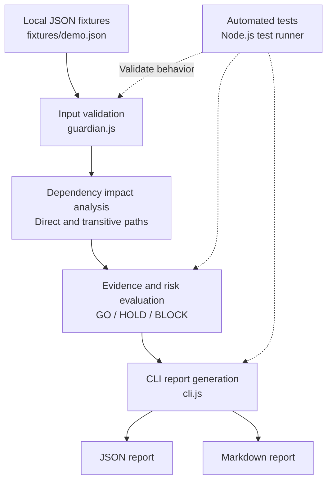

# Agentia Release Guardian - Change Impact & Release Evidence

## Overview

Agentia Release Guardian is an explainable prototype that analyzes Salesforce release scenarios and helps reviewers understand potential downstream impact, evidence gaps, and release risk.

It evaluates supplied change, dependency, and test-evidence data and produces one of three illustrative decisions:

- **GO** - evidence is complete and calculated risk is below the review threshold.
- **HOLD** - evidence is missing, not run, unrecognized, or the risk requires review.
- **BLOCK** - a required evidence check has failed or the calculated risk reaches the blocking threshold.

The prototype is designed to make release reasoning easier to inspect. A decision includes a risk score, impacted components, dependency paths, evidence status, reasons, and a recommended next action.

**Important:** The analyzer currently processes local JSON fixtures. It does not retrieve live Salesforce metadata, run Salesforce tests, deploy metadata, or authorize a release.

## Key capabilities

- **Explainable decisions:** show why a scenario results in GO, HOLD, or BLOCK.
- **Dependency impact tracing:** identify direct and transitive downstream components, with readable paths and cycle protection.
- **Evidence-aware review:** prevent missing, not-run, or unrecognized evidence from silently passing; failed required evidence results in BLOCK.
- **Repeatable reporting:** generate JSON and Markdown reports from the same analysis.
- **Automated validation:** test decision rules, dependency traversal, input validation, and report generation.

These capabilities operate on supplied local fixture data in this prototype; live Salesforce metadata retrieval and test execution are not implemented.

## Problem

A change to one Salesforce component can affect other components that depend on it. Reviewers also need to understand whether required test evidence is available and whether known failures should prevent a release from proceeding.

Release Guardian demonstrates how dependency traversal and evidence checks can be combined into a transparent, repeatable analysis rather than presenting a decision without explanation.

## Architecture



The diagram represents the current local implementation. It does not imply a live connection to Salesforce or Copado.

## How it works

The prototype is located in `release-guardian/`.

1. **Load scenarios:** `fixtures/demo.json` supplies three example release scenarios.
2. **Validate inputs:** `src/guardian.js` checks scenario structure, component severity, dependency data, and evidence statuses.
3. **Trace downstream impact:** the analyzer traverses dependencies, protects against cycles, and reports each impacted component once with its impact type and path.
4. **Evaluate evidence and risk:** the analyzer applies the project's deterministic scoring and decision rules.
5. **Generate reports:** `src/cli.js` writes JSON and Markdown reports from the same analysis results.
6. **Run automated tests:** `test/guardian.test.js` covers validation, scoring, dependency traversal, report generation, and CLI behavior.

### Direct and transitive impact example

The high-impact demo scenario uses this dependency chain:

`PricingService → OrderCalculator → CheckoutFlow`

When `PricingService` changes:

- `OrderCalculator` is a **direct** downstream impact.
- `CheckoutFlow` is a **transitive** downstream impact through `OrderCalculator`.

The Markdown report includes the path for each finding so reviewers can see why a component was identified.

## Risk scoring and decision rules

Risk scoring is deterministic and capped at 100.

| Contribution | Rule |
|---|---|
| Changed component severity | Low: 5 points; medium: 12 points; high: 25 points per change |
| Downstream impact | 10 points per unique impacted component, capped at 30 |
| Missing, not-run, or unknown evidence | 12 points per item, capped at 25 |
| No evidence supplied | Adds one missing-evidence contribution |

Decisions are evaluated in this order:

1. Any failed evidence check results in **BLOCK**, regardless of score.
2. Missing, not-run, or unknown-status evidence results in **HOLD**, never GO.
3. Otherwise, a score of 70 or higher results in **BLOCK**.
4. Otherwise, a score of 35 or higher results in **HOLD**.
5. A score below 35 with complete, recognized, passing evidence results in **GO**.

Invalid scenario structures and invalid severities produce actionable validation errors. Unknown evidence status strings are reported and cannot silently pass.

These weights and thresholds are illustrative project rules, not a production release policy.

## Demo scenarios

The included fixture demonstrates three outcomes:

| Scenario | Decision | Risk | Reason |
|---|---|---:|---|
| Low-risk change with complete evidence | **GO** | 5/100 | Both supplied checks passed and no downstream impacts were identified. |
| High-impact change with missing regression evidence | **HOLD** | 57/100 | Two downstream components were identified and regression evidence is missing. |
| Release with a failed required test | **BLOCK** | 12/100 | A required evidence check failed, regardless of the numerical score. |

## Prerequisites

- Node.js 18 or later.
- No additional npm packages are required by the Release Guardian application itself.

The repository root also contains a Salesforce development project with its own tooling and test configuration. The commands below target the Release Guardian application.

## Run the demo

From the repository root, open PowerShell and run:

```powershell
.\scripts\run-release-guardian-demo.ps1
```

The demo runner executes the Release Guardian automated tests, generates reports, and prints the decisions for the three fixture scenarios.

Alternatively, run the application commands separately:

```powershell
npm --prefix .\release-guardian test
npm --prefix .\release-guardian run guardian
```

Or enter the application folder:

```powershell
cd .\release-guardian
npm test
npm run guardian
```

## Generated reports

After a successful run, the reports are written to:

- `release-guardian/reports/release-guardian-report.json`
- `release-guardian/reports/release-guardian-report.md`

The reports include decisions, risk scores, changed and impacted components, dependency paths, evidence summaries, decision reasons, and recommended next actions.

## Tests

The Release Guardian test suite uses Node's built-in test runner. The latest verified test run passed **16 tests with zero failures**.

Run the tests again after making changes to verify the current state of the project.

## Agentia and Copado integration boundary

The project includes Agentia skill files to describe safe workflows for local analysis and Copado CI/CD context.

Separately, the Agentia CLI was used to query Copado CI/CD environment information and validate an environment credential. This confirms that those specific CLI operations succeeded; it does **not** mean that Release Guardian itself reads live Salesforce metadata, runs Salesforce tests, or performs deployments.

No release promotion, deployment, or production mutation is performed by the local demo runner.

## Limitations and safe use

- Dependency and evidence data are hand-authored local fixtures, not retrieved from an org or pipeline.
- The risk weights and thresholds are illustrative and must be reviewed against a team's actual release policy before operational use.
- A **GO** is an analysis result, not deployment approval or a guarantee of release safety.
- Live Salesforce metadata analysis, automated Salesforce test execution, and deployment integration have not been demonstrated in this prototype.
- Do not use the prototype as the sole basis for authorizing a production release.

## Project structure

```text
release-guardian/
  fixtures/
    demo.json
  src/
    guardian.js
    cli.js
  test/
    guardian.test.js
  reports/
    release-guardian-report.json
    release-guardian-report.md

scripts/
  run-release-guardian-demo.ps1

.agents/
  skills/
    agentia-cicd/
    release-guardian/
```

## Project goal

Demonstrate an explainable, testable approach to Salesforce release risk analysis, with readable direct and transitive impact paths, explicit evidence handling, deterministic decisions, and clear limitations.
